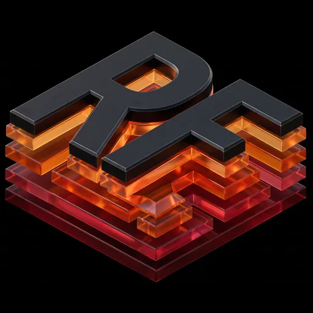

<p align="center">
  
</p>

# RealmForge XR

Shape a miniature world with your hands, drop in a robot, and watch it re-route when you move a wall.
MOLTEN Hackathon, Worldbuild track. Runs in the Meta Quest browser (WebXR) and on desktop.

## Run

```bash
npm install
npm run dev        # https://localhost:5173 (and your LAN IP, for the Quest)
npm test           # grid + A* unit tests
npm run build
```

On the Quest 3S, open `https://<laptop-LAN-IP>:5173` in the Quest Browser, accept the self-signed
certificate, choose **Launch editor**, then press **Enter AR** (passthrough) or **Enter VR**.

## Environment variables

Shared secrets live in `.env`, committed **encrypted** with [dotenvx](https://dotenvx.com).
`npm run dev` decrypts it automatically, as long as you have the private key.

- One-time setup: get `DOTENV_PRIVATE_KEY` from Abel (sent privately, never in git) and put it in a
  file named `.env.keys` in the repo root (`DOTENV_PRIVATE_KEY="..."`), or export it in your shell.
- Add or change a variable: `npm run env:set -- NAME value`, then commit `.env`. Teammates get it on pull.
- `.env.keys` and `*.local` are gitignored. Never commit the private key.

## Docs (living)

We document as we build. Update these in the same change when behavior or state moves:

| Doc | Purpose |
| --- | --- |
| [docs/demo-readiness.md](docs/demo-readiness.md) | What’s on `main` + Quest hardware checklist |
| [docs/controls-guide.md](docs/controls-guide.md) | Shared web/VR user & controls guide |
| [docs/quest2-testing.md](docs/quest2-testing.md) | Headset setup + gesture checklist |
| [docs/plan.md](docs/plan.md) | Best-of-both roadmap (Abel product + Emiliano headset) |
| [docs/BUILD_LOG.md](docs/BUILD_LOG.md) | Append-only work diary |
| [docs/CHANGELOG.md](docs/CHANGELOG.md) | User/demo-facing changes |
| [docs/STATE.md](docs/STATE.md) | Runtime & data state (store, XR, placement) |

## Controls

Every control is a pointer event, so mouse, controller rays and hand rays behave the same.

| Tool (key) | What it does |
| --- | --- |
| 1 Select / move | Drag an object to move it. Yellow handle resizes, blue handle rotates. |
| 2 Draw wall | Press on the ground, drag, release. |
| 3 Building | Click the ground to drop a building. |
| 4 Set goal | Click the ground to move the goal flag. |
| 5 Place robot | Click the ground to teleport the robot. |
| 6 Platform / road | Drag out a rectangle. Asphalt makes a road with a centre line. |
| 7 Decoration | Click to place a tree, streetlight or crate (pick in the inspector). |
| B | Demo helper: slides a wall across the robot's route to force a replan. |
| Enter AR | Starts passthrough with Quest fallback (`full` → `no depth` → `minimal`). |
| P Place city | In AR: highlight Space Setup planes; click a table/floor to pin the miniature (optional anchor). |
| R / Shift+R, `[` `]`, Del | Rotate 15°, lower/raise height, delete the selected object. |
| D, M, T, G | Duplicate, cycle material/style, toggle flat/pitched roof, toggle grid snapping. |
| X, V | Toggle XR rays; toggle Real / Virtual ground. |
| ? / **Guide** | Open the user & controls guide (same content in VR from wrist or control panel). |

A selected object shows drag handles (yellow sphere resizes, blue sphere rotates) and press
buttons (green cube duplicates, purple cube cycles material/style, red cube deletes). They are
ordinary pointer targets, so they work with controller and hand rays too.

In **VR/AR**, use hand grab (rays default off), the left-wrist menu, and the floating control
palette. Open **Guide** anytime for short, sectioned help.

The **inspector** (top right, desktop) sets exact dimensions, material, building style and roof,
picks what the creation tools place, toggles snapping, and loads environments
(**Forge District**, **Mars Outpost**, **Autonomous Warehouse** — see [docs/environments.md](docs/environments.md)).
Loading a preset asks before replacing a world that has objects in it.

On desktop, drag empty ground to orbit the camera.

## How it fits together

```
src/world/types.ts         shared schema + map constants (the contract)
src/world/store.ts         Zustand world store: objects, goal, robot start, editor tool/selection
src/world/serialize.ts     versioned realmforge-world JSON + validation
src/world/persistence.ts   localStorage save/load, export/import (UI-agnostic)
src/world/history.ts       undo/redo with drag coalescing (UI-agnostic)
src/nav/grid.ts            obstacle footprints -> occupancy grid (rotated rects, inflated by robot radius)
src/nav/astar.ts           8-connected grid A* + line-of-sight smoothing
src/nav/navigation.ts      replans on every geometry/goal/robot change; flags routes an edit blocked
src/agent/Robot.tsx        primitive robot that follows waypoints
src/world/catalog.ts       object defaults, building styles, material lists, style cycling
src/world/snap.ts          grid / angle snapping helpers
src/world/presets.ts       preset layouts (Forge / Mars / Warehouse)
src/world/environment.ts   environment config + loadEnvironment() API
src/world/actions.ts       XR-safe World Action API (see docs/xr-world-actions.md)
src/world/eventCatalog.ts  Universal event furniture / booths / wayfinding catalog
src/sim/*                  Single-attendee event simulation MVP
src/voice/*                AssemblyAI voice commands (see docs/voice-commands.md)
src/editor/*               pointer editing + XR grab, wrist menu, rays/surface (Quest)
src/xr/*                   AR enter fallback, Place city plane pinning
src/scene/worldRoot.ts     presentation scale presets (tabletop → life size); store stays metres
src/scene/structures/      how each object kind is drawn (buildings, walls, platforms, decorations, props)
src/scene/materials.ts     procedural canvas textures + shared, cached materials
src/scene/*                scene graph, lighting, route + goal visuals
```

World save/load and undo/redo: `docs/world-persistence.md`. Quest XR testing: `docs/quest2-testing.md`.
**Scale contract:** store / nav / saves use metres; `WORLD_ROOT.scale` is presentation only.

### Shared object contract

```ts
interface WorldObject {
  id: string                  // stable, never reused
  kind: 'wall' | 'building' | 'platform' | 'tree' | 'streetlight' | 'crate'
  position: [x, y, z]         // base centre of the footprint, map units, y = 0 on the ground
  size: [width, height, depth]// full extents along local x, y, z
  rotationY: number           // yaw in radians; only yaw affects navigation
  color?: string
  // Optional, visual only (older objects without them still work):
  material?: 'concrete' | 'brick' | 'metal' | 'glass' | 'wood' | 'asphalt' | 'grass'
  style?: 'tower' | 'office' | 'house' | 'industrial'  /* buildings */ | 'round' | 'pine' /* trees */
  roof?: 'flat' | 'pitched'   // buildings
  solid?: boolean             // override whether it blocks navigation
}
```

**What blocks the robot** is decided in one place, `blocksNavigation()` in `src/world/types.ts`:
walls and buildings always block; platforms block only when taller than `STEP_HEIGHT` (0.3), so
roads and plazas are walkable; trees, streetlights and crates never block unless `solid` is set.
Navigation builds its grid from `navObstacles(objects)`; the grid and A* code are unchanged.

- **Units:** 1 map unit = 1 m. The map spans ±`WORLD.half` (40) on x and z with 0.5-unit grid cells.
- **Miniature:** everything is drawn inside one root group (`src/scene/worldRoot.ts`) with
  presentation scale presets (tabletop → life size). Store values stay map-local metres; convert a
  pointer ray with `groundPoint(event)`.
- **Edits trigger navigation** through the store: `addObject`, `updateObject` and `removeObject`
  bump `geometryVersion`, and navigation rebuilds the grid and replans. XR input only needs to call
  these actions; it never talks to navigation directly.

### What is honest to claim

The robot uses grid A* over an occupancy grid built from obstacle footprints. It is not a physics
or robotics simulation.

## Unified integration handoff

See [integration audit and merge order](docs/unified-integration.md),
[demo readiness and hardware record](docs/demo-readiness.md), and
[XR menu contract](examples/unified-xr-contract.ts).
Desktop voice supports start/stop, hold-to-talk, and a typed command fallback.
World replacements use a shared confirmation dialog; an XR menu must provide its own consumer.

## Warehouse object catalog

The inspector's **Object catalog** and the VR palette's **Assets / Routes** tabs add warehouse equipment,
placement previews and usable robot destinations. Load Autonomous Warehouse to see the seeded objects.
Choose an item, aim at clear ground and click to place; key **8** selects catalog placement and **R** rotates it.
See [warehouse catalog workflow and validation](docs/warehouse-catalog.md).

## Project landing page

The root URL introduces RealmForge XR. **Launch editor** opens `?editor=1`; environment cards
open the editor with the selected template (`?editor=1&world=warehouse`, for example).
The world editor and XR modules load only when the editor is launched.
See [landing page verification](docs/landing-page.md).
